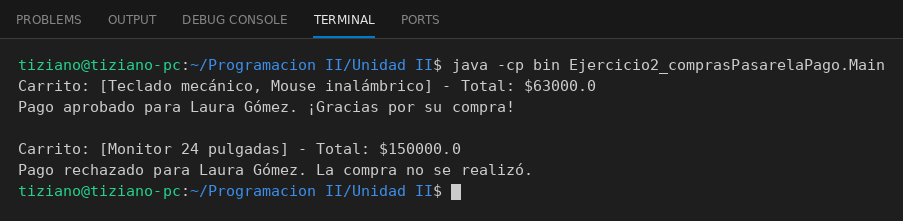

# PasarelaDePagos

Programación II - Unidad 2 - Ejercicio 2

## Consigna
El carrito de compras delega el cobro en una pasarela de pagos y interpreta la respuesta booleana.

## Lógica
- `Tarjeta`: número y titular.
- `PasarelaDePagos.procesarPago(monto, tarjeta)`: retorna `true` si el número tiene 16 dígitos y el monto es positivo y no supera el límite por operación.
- `CarritoDeCompras`: acumula productos y un total, y tiene una referencia a la pasarela; `pagar(tarjeta)` le envía el mensaje de cobro y, según el booleano, confirma la compra (vaciando el carrito) o la rechaza.
- `Main`: simula una compra exitosa y otra rechazada por tarjeta inválida.

## Ejecución

